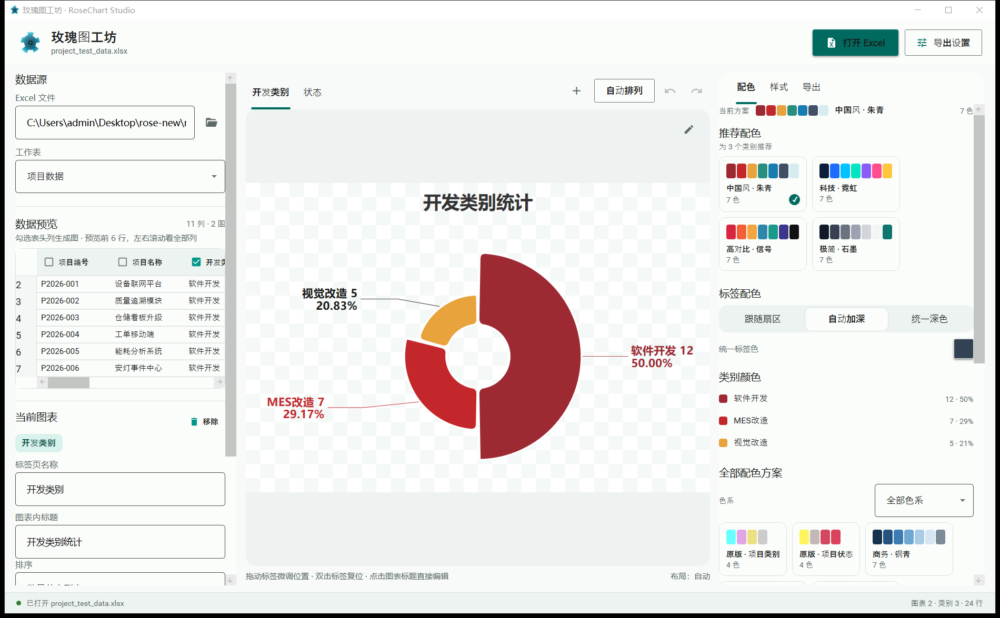

# 玫瑰图工坊 · Rose Plot

一个把 Excel 数据变成**南丁格尔玫瑰图**的桌面应用。当前主线是 **.NET 10 + WPF** 的 RoseChart Studio，旧版 Python/Tkinter 应用保留在 `rose/` 目录。



## 当前版本：WPF v3.1 · Material 3

- **任意 Excel 列**都可以生成玫瑰图，不再限制“项目/状态”两类统计；
- 左侧真实表格预览：显示真实表头、Excel 行号和前 6 行数据，勾选表头列即可生成图表；
- 动态图表标签页：可同时打开多张图，支持添加、删除、切换；
- 每个图表独立保存配色、标签、排序、标签位置和标题；
- 图表标题支持在预览画布内直接点击编辑；
- 拖拽数据标签、双击标签复位、Ctrl+Z / Ctrl+Y、自动排列；
- 配色推荐、按类别改色、标签配色模式；
- 导出 PNG / SVG / PDF，支持透明背景和自定义文件名模板；
- 导出后自动打开所在文件夹；
- Material Design 3：Material AppBar、按钮、outlined 输入框、复选框、滑杆、卡片、图标和 Material 滚动条。

## 目录

```text
rose/    旧版 Python/Tkinter 玫瑰图应用（保留对照）
wpf/     WPF/.NET 10 主线应用、测试、性能与 QA 证据
```

- WPF 说明：[wpf/README.md](wpf/README.md)
- QA 截图与证据：[wpf/_qa/README.md](wpf/_qa/README.md)
- 示例数据：`project_test_data.xlsx`

## 构建与运行

前置：Windows 10/11 x64、.NET 10 SDK。

```powershell
cd wpf
.\build.ps1
.\run.ps1 --sample
```

只运行已构建版本：

```powershell
wpf\RoseChartStudio.App\bin\Release\net10.0-windows\RoseChartStudio.exe
```

测试：

```powershell
wpf\test.ps1
```

## 旧版 Python 应用

```powershell
cd rose
python -m venv .venv
.\.venv\Scripts\pip install -r requirements.txt
python app.py
```

## 已知限制

- 当前统计方式仅支持按行数计数（数值求和等聚合尚未实现）；
- 仅支持 `.xlsx/.xlsm`，不支持旧 `.xls`；
- PDF 中文字为矢量轮廓，不能选中/搜索；
- 打包发布（self-contained 单文件 exe）尚未作为正式流程；
- 旧版 Python 代码保留但不再是主线。

## 开发验证

WPF 核心测试当前 **165/165 通过**，图表拖拽性能记录于 `wpf/_qa/perf/wpf_perf.json`。
