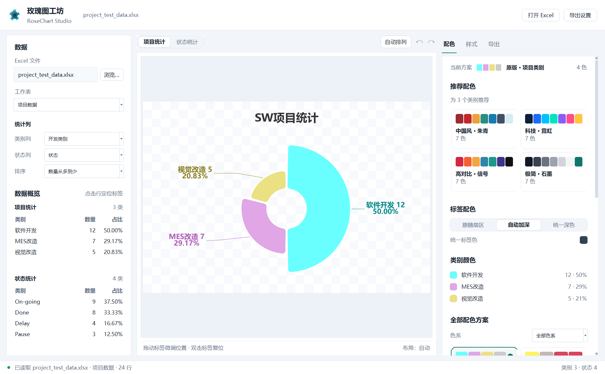
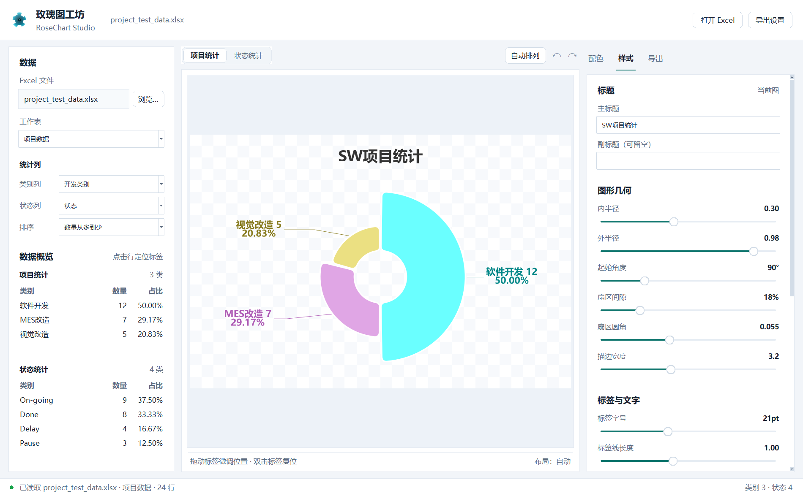
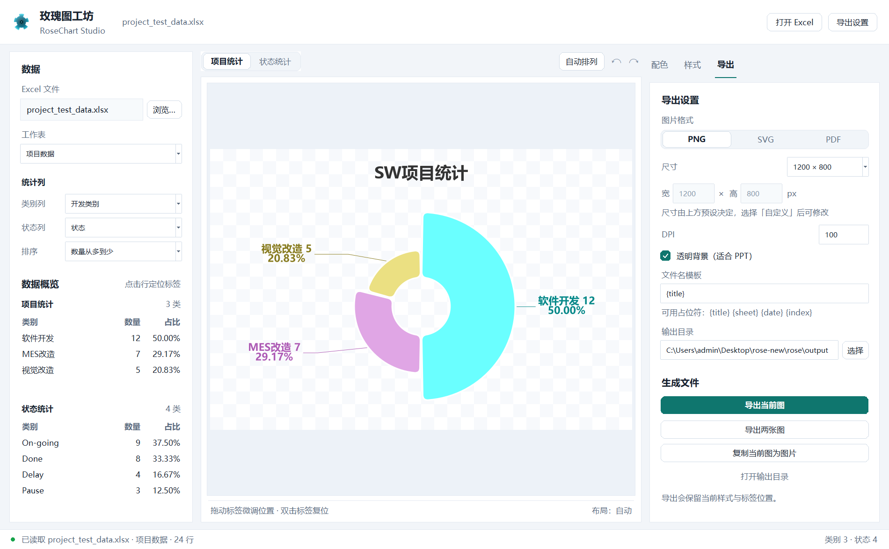
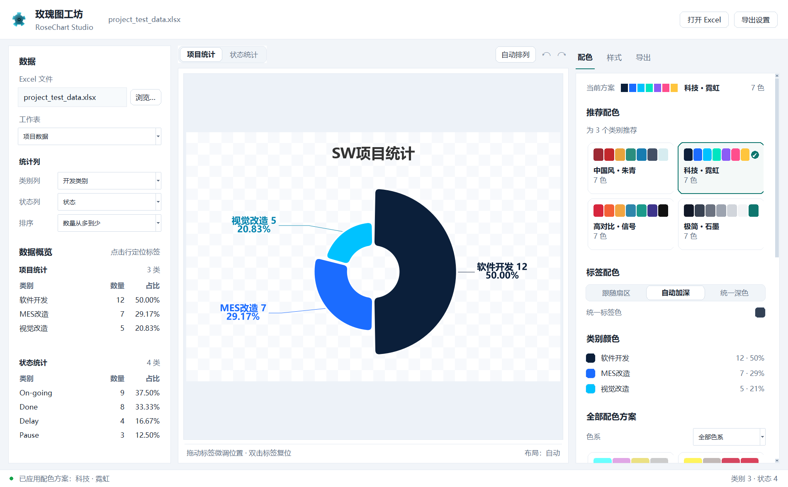

# 玫瑰图工坊 · RoseChart Studio

从 Excel 直接生成南丁格尔玫瑰图的 Windows 桌面软件。内置 **16 套色系方案与智能推荐**，支持 **鼠标拖拽调整数据标签位置**、实时预览、样式微调和高清导出，打包为免安装便携版，双击 `RoseChart.exe` 即可使用。



## 快速开始

1. 双击 `RoseChart.exe`（或 `start.bat`）。
2. 点击「打开 Excel」选择工作簿（也可直接把示例 `examples/project_test_data.xlsx` 拖进资源管理器打开后选择）。
3. 程序自动识别「开发类别 / 状态」两列并生成两张玫瑰图，第一张显示在中间预览区。
4. 在右侧「配色 / 样式 / 导出」面板中调整效果，完成后导出 PNG。

整个 `rose` 文件夹是便携版：**复制到任意 Windows 64 位电脑，双击 `RoseChart.exe` 即可运行**，目标电脑无需安装 Python、无需联网。请连同 `.venv` 文件夹一起复制。

## 界面与功能

### 左侧：数据源
- 选择 Excel 文件、工作表。
- 自动识别统计列：`开发类别`（项目图）和 `状态`（状态图）；也可以手动切换成任意列，或选择「（不使用）」只生成一张图。
- 数据概览表实时显示每个类别的数量与占比；可切换数量/名称排序。
- 支持 `.xlsx` / `.xls` / `.xlsm`。

### 中间：实时预览与标签拖拽
- 「项目统计 / 状态统计」两个面板分别编辑两张图。
- **鼠标拖动任意数据标签**即可微调位置，引线自动跟随；**双击标签**恢复该标签的自动位置。
- 工具栏提供「自动排列」、撤销（Ctrl+Z）、重做（Ctrl+Y）。
- 自定义的标签位置按类别名记录，切换配色、改字号后仍会保留；导出时一并生效。
- 透明背景以棋盘格预览，所见即所得。

### 右侧：配色 / 样式 / 导出
- **配色**：按当前类别数量智能推荐 4 套方案，可按色系分组浏览全部 16 套；标签颜色支持「跟随扇区 / 自动加深 / 统一深色」（自动模式保证白底可读性）；每个类别还可以单独改颜色。
- **样式**：内/外半径、起始角度、扇区间隙、圆角、描边、标签字号、引线长度/宽度、标题字号、显示名称/数量/百分比、百分比小数位、数值后缀、字体、中心文字、画布背景（透明/白色/自定义）。
- **导出**：PNG / SVG / PDF；预设尺寸或自定义宽高、DPI；透明背景开关；文件名模板（`{title}` `{sheet}` `{date}` `{index}`）；一键导出当前图或两张图。

### 项目与设置
- `Ctrl+S` 保存 `.roseproj` 项目文件，保留数据源、配色、样式、标签位置，下次直接打开继续编辑。
- 退出时自动记忆上次的窗口位置、文件、配色和样式（保存到 `rosechart_prefs.json`，可删除以恢复默认）。

## 界面预览

样式面板（全部参数实时生效，拖动标签后仍可继续调整）：



导出面板（PNG / SVG / PDF、尺寸、DPI、透明背景、文件名模板）：



配色方案切换示例（「科技 · 霓虹」）：



## 快捷键

| 快捷键 | 功能 |
| --- | --- |
| `Ctrl+O` | 打开 Excel |
| `Ctrl+S` | 保存项目 |
| `Ctrl+E` | 导出当前图 |
| `Ctrl+Z` / `Ctrl+Y` | 撤销 / 重做标签调整 |
| `Ctrl+R` | 自动排列标签 |
| `F1` | 使用说明 |

## Excel 格式要求

目标工作表至少包含用于统计的列，推荐：

- `开发类别`（项目类型列，第一张图）
- `状态`（第二张图，例如 `On-going` / `Done` / `Pause` / `Delay`）

程序会自动识别常见列名（如 项目类型 / 进展 / 状态 等），识别不到时可手动选择；空值、空格会自动清理。

## 目录结构

```
rose/
├─ RoseChart.exe           Windows 启动器（无控制台，内嵌图标）
├─ start.bat               备用启动脚本
├─ app.py                  程序入口（DPI 感知、崩溃日志、命令行参数）
├─ render_charts.py        无界面命令行渲染（批量/自动化用）
├─ rosechart/              应用代码
│  ├─ main_window.py       主窗口：数据、预览、配色、样式、导出
│  ├─ chart.py             玫瑰图渲染引擎 + 标签拖拽模型
│  ├─ palettes.py          16 套色板、推荐算法、对比度工具
│  ├─ data.py              Excel 读取、列识别、统计
│  ├─ prefs.py             设置与 .roseproj 项目文件
│  └─ ui_widgets.py        自绘控件库（按钮/滑块/色板卡片等）
├─ assets/                 应用图标
├─ examples/               示例 Excel 与最初的原型 notebook
├─ output/                 默认导出目录
├─ tests/                  色板模块单元测试
└─ _qa/                    开发期测试脚本、截图与验收证据
```

## 开发 / 重新构建

便携运行时为 `.venv`（Python 3.11 + matplotlib/pandas/openpyxl/Pillow，无网络依赖）：

```powershell
# 运行测试（色板单元测试 + 图表边界用例）
.\run_tests.ps1

# 无界面批量生成两张 PNG
.\.venv\python.exe render_charts.py --input examples\project_test_data.xlsx

# 重新构建 RoseChart.exe（需要 Windows 自带的 .NET Framework csc.exe）
pwsh -File .\build_launcher.ps1
```

启动器源码与图标生成脚本在 `_qa/packaging/` 中；应用图标位于 `assets/icon.ico`。

## 常见问题

- **双击 exe 没反应**：查看同目录 `rosechart_error.log`；确认复制了完整文件夹（`.venv` 不能缺）。
- **图表中文变方块**：程序会优先使用微软雅黑/黑体等系统字体；可在「样式 → 字体」中手动选择。
- **透明背景看不到**：导出 PNG 时保持「透明背景」开启；预览区的棋盘格仅用于示意。
- **标签位置不合适**：拖动标签微调，或点「自动排列」恢复；双击单个标签可单独复位。
- **想恢复默认设置**：删除目录下的 `rosechart_prefs.json` 后重新打开。

## 版本

- v2.1：UI 整体重构——面板化 Inspector、统一字阶与控件语法、空状态、表格点击定位、标签描边可读性。
- v2.0：桌面软件化 — 色系推荐、标签拖拽、实时预览、样式面板、多格式导出、项目文件、便携 exe。
- v1.0：初版 Excel → 玫瑰图 PNG 生成器（Tkinter + matplotlib）。
