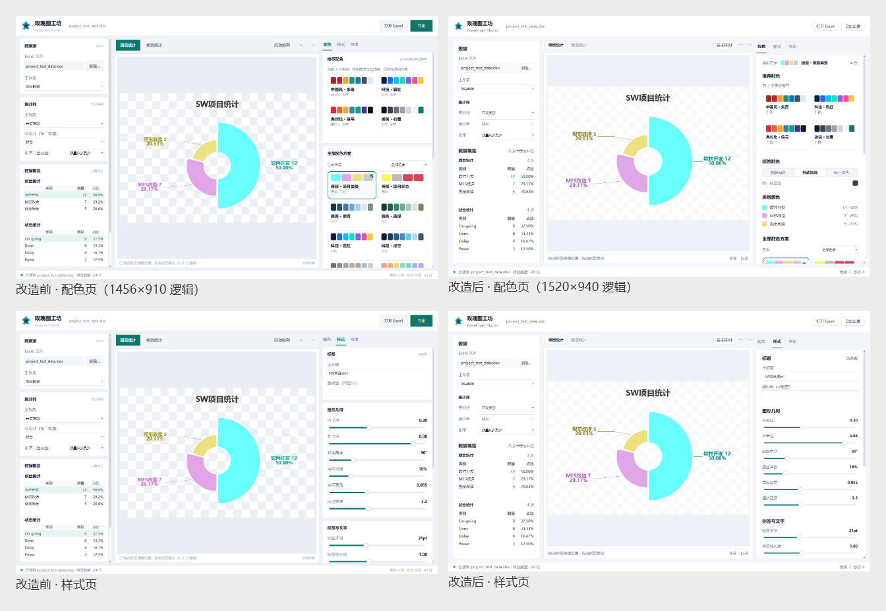

# UI 重构证据与说明（oil-ui 存量界面优化）

本目录是「玫瑰图工坊 · RoseChart Studio」v2.1 UI 整体重构的设计说明、状态截图与验收证据。

## 北极星
**安静的数据工作台**：图表是唯一主角，界面像一台校准过的仪器——克制的青灰、精准的发丝线、清楚的层级，颜色和注意力都留给图表本身。

## 改造前后


- 改造前：卡片套卡片、每条边都画线；辅助文字 8.5–9.5pt 偏小；按钮/分段/Tab/Emoji 提示四套控件语法；表头与数据不齐；表格选中是假交互。
- 改造后：左右栏为整片白色 Inspector 面板 + 分节标题与留白分组；字号统一到 10–14pt；圆角按钮、Canvas 分段控件、下划线 Tab 三套语法各司其职；表头对齐；点击数据表行会在图表中定位标签；空状态给行动入口。

## 规范（实现值）
| 项 | 值 |
| --- | --- |
| 应用底色 | `#F2F5F9` |
| 面板 | `#FFFFFF` + 1px `#E3E9F1` |
| 主文字 / 辅助 | `#182230` / `#5C6B7F` |
| 品牌主色 | `#0F766E`（来自应用图标） |
| 预览画布底 | `#EDF2F8` |
| 字体 | Microsoft YaHei UI；9.5 / 10 / 10.5 / 11 / 11.5 / 14pt |
| 间距 | 4 / 8 / 10 / 14 / 16 / 18 / 20 / 26（逻辑 px） |
| 控件 | 32/28px 高圆角按钮（7px），Canvas 分段控件，下划线 Tab，自绘滑杆/复选框/色板卡 |

## 证据文件
| 文件 | 内容 |
| --- | --- |
| `before/` | 改造前 6 个状态基线截图 |
| `after/01_palette.png` | 配色页（默认 1520×940 逻辑视口，125% DPI） |
| `after/02_style.png` | 样式页 |
| `after/03_export.png` | 导出页（唯一主操作 / 尺寸主从 / 无原生 stepper） |
| `after/04_palette_neon.png` | 配色切换示例 |
| `after/04b_palette_library.png` | 全量色板库：当前色板的次级「已选」标记 |
| `after/05a_dragging_mid.png` | 拖拽进行中：标签落在深色扇区时自动白底板 |
| `after/05_dragging.png` | 拖拽结束 + 自定义布局 |
| `after/06_empty_state.png` | 空状态（统计列未配置） |
| `after/07_small_window.png` | 最小窗口 **1440×870** |
| `after/09–11_*_2x.png` | 左栏 / 右栏 / 工具栏 200% 局部检查 |
| `after/12–13_*.png` | 样式页底部、配色页中段滚动状态 |
| `after/14_export_panel_2x.png` | 导出面板 2x |
| `after/15_small_canvas_2x.png` | 最小窗口画布 2x |
| `evidence/01_palette_480.png` | 480px 缩略检查 |
| `evidence/before_after_sheets.png` | 改造前后并排（oil_ui_shoot stitch） |
| `evidence/after_states.png` | 六个关键状态并排（oil_ui_shoot stitch） |
| `design-notes.md` | 设计说明、盘点、改动清单 |
| `shoot_ui.py` | 可复现截图脚本 |

## 复现
```powershell
.venv\python.exe -B _qa\ui_redesign\shoot_ui.py
```

## 视觉评审与修正
按 oil-ui「存量已有界面润色评审」完成一轮独立评审（不打分），并逐条修正：图内标签对比与引线可见性、最小窗口主图尺度（最小窗口提高到 1440×870）、导出页单一主操作、尺寸预设/自定义主从、移除原生 stepper、表头锚线与百分比精度、配色页「当前方案 → 标签 → 全量库」顺序、色板去双勾、棋盘纹理退后、空状态与重复文字减法。完整对照表见 [design-notes.md](design-notes.md)。

## 动效说明
本次是存量界面润色，没有新增页面级动效。控件级即时反馈：按钮 hover / pressed / focus、分段控件 hover 与键盘左右键、滑杆 hover/drag/focus、色板卡 hover/focus、Tab hover、自定义滚动条按需出现。只有静态截图，未录制原生窗口录屏；不把动效评为通过。`05a_dragging_mid.png` 为拖拽进行中的静态证据，可用于核对拖拽视觉状态。
